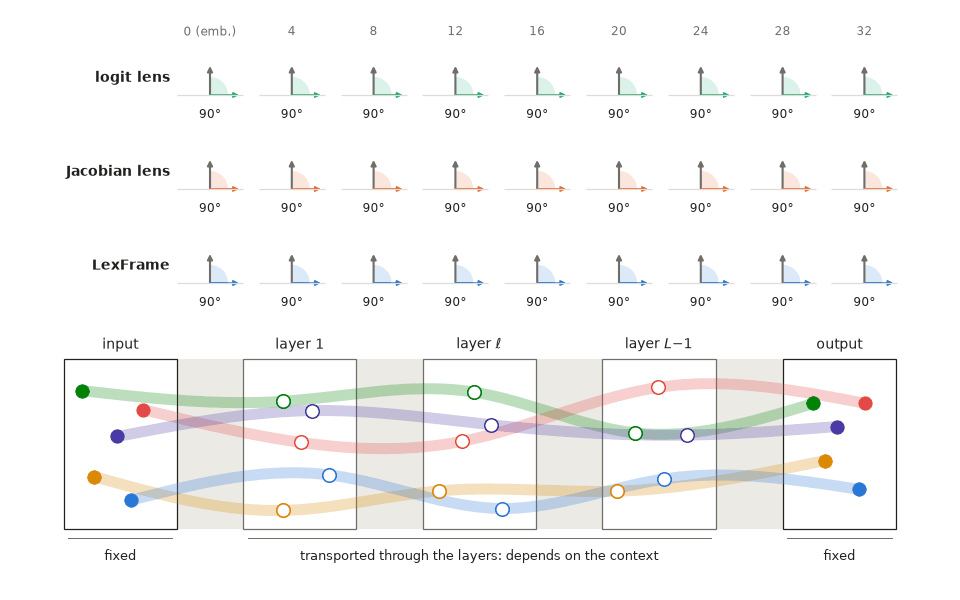
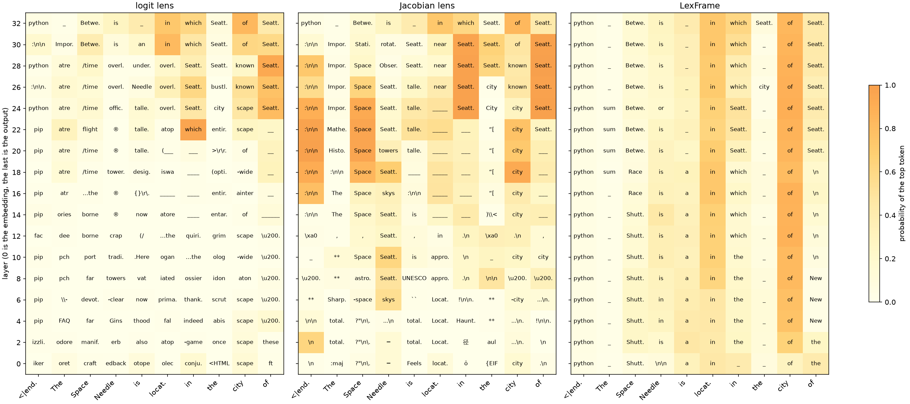

<h1 align="center">LexFrame: Lexical Reference Frames</h1>

<p align="center">A toolkit for interpreting LM residual streams in their native semantics.</p>

<p align="center">
  <a href="https://pypi.org/project/lexframe/"></a>
  <a href="https://github.com/jianguda/lexframe/actions/workflows/workflow.yml"></a>
  <a href="https://arxiv.org/abs/2610.22169"></a>
  <a href="https://jianguda.github.io/blogs/lexframe/"></a>
</p>

<p align="center"></p>

LexFrame reads every hidden state of a language model, at every layer and position, in the model's own vocabulary: its logits, its gradients, and the semantic bases that carry both, for every label.
It is **model-native**: the state runs through the model's own remaining layers, calibrated once on unlabelled text, with nothing fitted to the output.
It is **context-aware**: it separates what the state carries by itself from what the context adds later, and steers or ablates the model's run with the full context, carrying every move forward to the output.

## Quickstart

```bash
pip install lexframe
```

```python
import lexframe as lf

frame = lf.LexFrame(model, tokenizer).init(texts)            # a loaded Hugging Face model and any unlabelled texts
text = "The Eiffel Tower is located in the city of"
s = frame.state(text)                                        # the hidden states of every layer and position
s[:, -1].logits().softmax(-1).topk(5)                        # logits: the top 5 labels that each layer's state carries
moved = s[16, -1].steer({" Paris": -4, " London": 4})        # steer: move layer 16 from Paris toward London
moved[-1, -1].logits().softmax(-1).topk(5)                   # the model's output after the move
s[13, -1].ablate()[-1, -1].logits().softmax(-1).topk(5)      # ablate: the output without layer 12's write at the last position
b = s[16, -1].basis([" Paris", " London"])                  # basis: the labels' semantic bases at a state (None: all)
```

[docs/USAGE.md](https://github.com/jianguda/lexframe/blob/main/docs/USAGE.md) describes every command, from logits, gradients and semantic bases to steering and ablation, and [examples/walkthrough.py](https://github.com/jianguda/lexframe/blob/main/examples/walkthrough.py) puts them to work: where SmolLM3 decides that the Eiffel Tower is in Paris, who wrote that decision, and how to change it. [examples/visualize.py](https://github.com/jianguda/lexframe/blob/main/examples/visualize.py) plots every layer's logits and where the state sits among the semantic bases. Explore LexFrame directly with the [quickstart in Colab](https://colab.research.google.com/github/jianguda/lexframe/blob/main/examples/quickstart.ipynb).

## Mechanism

LexFrame carries each state through the model's own remaining layers and reads it at the output. Other positions enter a layer only through its attention write, so every later write is replaced by its expectation given the state, calibrated once on unlabelled text: the logits are what the state carries by itself. The gradients are the model's own, and the semantic bases carry both: a state is the sum of the bases of the whole vocabulary weighted by its logits, and a move along a label's basis changes that label's logit by the step, to first order. Steering rotates a state at its norm so that chosen labels' logits change by given amounts and the other labels change least; ablation removes what a layer, a sublayer or one source position wrote; both run the model itself with the full context. Lenses instead read every state of a layer with one fixed map. [docs/MECHANISM.md](https://github.com/jianguda/lexframe/blob/main/docs/MECHANISM.md) explains the details.

<p align="center"></p>
<p align="center"><sub>The top token each method reads at every second layer of OLMo3-7B, for "The Space Needle is located in the city of" after the document start, shaded by its probability (Jacobian lens fitted on 100 sequences). The model answers " Seattle" (0.43). At the last position, LexFrame reads " Seattle" from layer 20, the Jacobian lens from layer 22 and the logit lens from layer 24.</sub></p>

## Compatibility

LexFrame supports any causal LM in 🤗 Transformers, including popular model families such as `Llama`, `Qwen`, `Gemma`, `Mistral` and `DeepSeek`, and compact or fully open ones such as `Phi`, `OLMo` and `MiniCPM`.

## Citation

```bibtex
@article{gu2026lexical,
  title={Lexical Reference Frames: Interpreting LM Residual Streams in Native Semantics},
  author={Gu, Jian and Zhang, Hongyu and Chen, Chunyang and Aleti, Aldeida},
  journal={arXiv preprint arXiv:2610.22169},
  year={2026}
}
```
